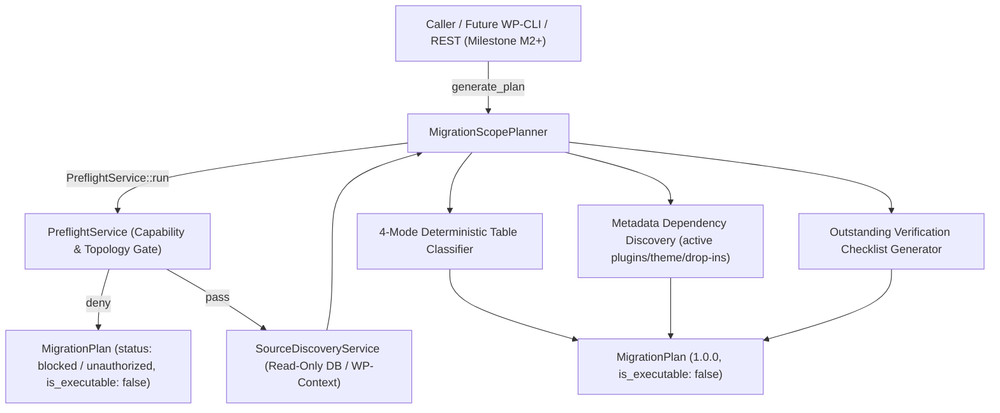

# Migration Scope Planner & Table Selection Contracts

> [!NOTE]
> **Task Reference:** `SITECONVOY-M1-003`  
> **Status:** IMPLEMENTED (`0.1.0-dev`) &mdash; READ-ONLY PREVIEW PLANNING ONLY  
> This document defines the PHP contracts, deterministic table selection rules, capability guards, metadata dependency resolution, and non-executable plan invariants introduced in `SITECONVOY-M1-003`. These components are strictly **read-only**: they do not export packages, import data, write options, modify database schemas, or expose admin/REST endpoints.

---

## 1. Subsystem Overview & Architecture

The `SITECONVOY-M1-003` planning subsystem extends the read-only discovery foundation (`SITECONVOY-M1-002`) by turning source discovery inventories and preflight evaluations into a deterministic, structured, and auditable preview plan:

| Class | File | Responsibility |
|---|---|---|
| `SiteConvoy\Contracts\MigrationPlan` | `includes/Contracts/MigrationPlan.php` | Immutable value object representing a planned migration preview. Implements `\JsonSerializable`. Guarantees `is_executable() === false` invariant. |
| `SiteConvoy\Planning\MigrationScopePlanner` | `includes/Planning/MigrationScopePlanner.php` | Deterministic scope planner validating authorization via `PreflightService`, classifying tables across 4 modes, discovering metadata dependencies, and building the `MigrationPlan`. |



---

## 2. Invariants & Security Boundaries

1. **Deterministic & Read-Only**:
   - `MigrationScopePlanner::generate_plan()` produces bit-identical plans across repeated runs on unchanged source databases.
   - It executes no write queries, creates no database locks, provisions no files, and modifies no options or transients.
2. **Fail-Closed Execution Guard (`is_executable === false`)**:
   - `MigrationPlan::is_executable()` unconditionally returns `false`.
   - The serialized JSON plan explicitly contains `"is_executable": false`.
   - Any plan with blocking preflight findings or missing prerequisites is created with `status: "blocked"` or `status: "unauthorized"`.
3. **Authorization & Defense-in-Depth**:
   - `MigrationScopePlanner::generate_plan()` invokes `PreflightService::run()`, requiring `manage_network` on multisite installations and `manage_options` on standalone installations.
   - Unauthorized attempts return a plan with `status: "unauthorized"`, an empty table manifest, and a blocking preflight finding `SC_AUTH_FORBIDDEN`.
4. **Current-Network Ownership & Isolation**:
   - `SourceDiscoveryService::enumerate_network_sites()` strictly validates any provided `$network_id`. Querying a foreign network ID throws `\InvalidArgumentException`.
   - In `MigrationScopePlanner`, site existence and current-network ownership are strictly checked against `get_site( $site_id )` and `(int) $site->site_id === (int) $wpdb->siteid`.
5. **Data Minimization & Zero Sensitive Data**:
   - Plans omit database passwords, salts, keys, user emails, password hashes, and user login names.
   - Dependency discovery reads only metadata (plugin names, version headers, theme text domain, and active option keys).

---

## 3. Four-Direction Table Selection Rules

WordPress core tables are categorized into four logical scopes:
- `blog`: Site-specific content tables (`posts`, `postmeta`, `comments`, `commentmeta`, `terms`, `termmeta`, `term_taxonomy`, `term_relationships`, `options`, `links`).
- `global`: User identity tables (`users`, `usermeta`).
- `ms_global`: Multisite network governance tables (`blogs`, `blogmeta`, `site`, `sitemeta`, `signups`, `registration_log`).
- `unresolved`: Custom or unclassified plugin tables present in the database.

Each table entry in the manifest receives a status:
- `included`: Selected as part of the extraction scope.
- `excluded`: Explicitly rejected from extraction with an audit reason.
- `needs_review`: Flagged for user or operator decision (e.g. shared user migration).
- `missing`: Expected core table absent from the database.
- `unresolved`: Custom table requiring administrator classification.

### Mode 1: Subsite &rarr; Standalone (`subsite_to_standalone`)
- **Blog tables**: All core blog tables for the subsite are marked `status: "included"`.
- **Main Site (Site ID 1) Isolation**: Site 1 blog tables share `$wpdb->base_prefix` (`wp_`) with `ms_global` tables. The planner specifically identifies `ms_global` tables and marks them `status: "excluded"` with reason: `Multisite network governance tables are excluded from single-subsite export.`.
- **User identity (`wp_users`, `wp_usermeta`)**: Categorized under `global` with `status: "excluded"` and reason: `Shared network user tables are excluded from automated subsite transfer; individual user accounts and roles require explicit selective mapping review.`.
- **Unresolved / Custom tables**: Prefixed tables matching the blog prefix are categorized under `unresolved` with `status: "unresolved"`.

### Mode 2: Subsite &rarr; Multisite (`subsite_to_multisite`)
- **Blog tables**: All core blog tables for the target subsite are marked `status: "included"`.
- **Multisite Global tables**: Marked `status: "excluded"`.
- **User identity (`wp_users`, `wp_usermeta`)**: Marked `status: "excluded"` under `global` for downstream selective identity mapping and collision detection on the destination network.
- **Unresolved tables**: Marked `status: "unresolved"`.

### Mode 3: Whole Multisite Network &rarr; New Environment (`full_network_to_new_env`)
- **Site ID validation**: `$source_site_id` must be `null`.
- **Multi-network guard**: If more than 1 network exists in `wp_site`, planning is blocked (`SC_MULTI_NETWORK_UNSUPPORTED`).
- **All Network Sites' Blog tables**: Enumerates all active sites via `get_sites()` and includes core blog tables for every site across the network.
- **Multisite Global tables**: Marked `status: "included"` under `ms_global` as candidates for network governance transfer.
- **User identity (`wp_users`, `wp_usermeta`)**: Marked `status: "needs_review"` under `global` with reason: `Network-wide user identity and authentication credentials require verification and password/cookie salt review at target.`.
- **Unresolved tables**: Marked `status: "unresolved"`.

### Mode 4: Standalone &rarr; Multisite Subsite (`standalone_to_subsite`)
- **Source environment**: Must be standalone (`is_multisite() === false`).
- **Blog tables**: All standalone blog tables are marked `status: "included"` under `blog` for downstream prefix rewriting and insertion.
- **Multisite Global tables**: None exist on source (`ms_global` category is empty array `[]`).
- **User identity (`wp_users`, `wp_usermeta`)**: Marked `status: "needs_review"` under `global` with reason: `Standalone user accounts require review for email/username collisions against destination multisite users before mapping.`.
- **Unresolved tables**: Marked `status: "unresolved"`.

---

## 4. Metadata-Only Dependency Extraction

The `dependencies` section inspects active runtime components without serializing code or executing side effects:
- **Active Plugins**: Extracted from `active_plugins` (or `active_sitewide_plugins` on network mode). Contains plugin file relative paths, Name, and Version (read via `get_file_data()` or `get_plugin_data()`).
- **Active Theme**: Current stylesheet, template, theme name, version, parent theme (if child theme), and theme text domain.
- **Drop-Ins & MU-Plugins**: Discovered via `wp_get_mu_plugins()` and standard WordPress drop-in filenames (`advanced-cache.php`, `object-cache.php`, `db.php`, `sunrise.php`).

---

## 5. Verification Checklist

The plan generates an outstanding verification checklist for operators and automated preflight validators before any future migration stage can proceed:

1. **User Identity Mapping**: Verification of administrator and author user accounts, email collisions, and role mappings.
2. **Domain & Path Rewriting**: Planning search-replace for old vs new URLs, HTTP vs HTTPS, and subdirectory vs subdomain structures.
3. **Uploads Filesystem Space**: Disk space verification for media files on destination filesystem.
4. **Active Plugin & Theme Availability**: Ensuring required themes and plugins exist on destination environment.
5. **Drop-in / Object Cache Evaluation**: Verifying custom cache drop-ins (`object-cache.php`) are compatible with destination infrastructure.
6. **Destination Write Freeze / Maintenance Window**: Establishing write locks or maintenance mode during cutover.

---

## 6. MigrationPlan JSON Schema (v1.0.0)

```json
{
  "$schema": "https://json-schema.org/draft/2020-12/schema",
  "title": "SiteConvoyMigrationPlan",
  "type": "object",
  "required": [
    "schema_version",
    "created_at",
    "operation_mode",
    "source_site_id",
    "is_executable",
    "status",
    "preflight",
    "tables",
    "dependencies",
    "verification_checklist"
  ],
  "properties": {
    "schema_version": { "type": "string", "const": "1.0.0" },
    "created_at": { "type": "string", "format": "date-time" },
    "operation_mode": { "type": "string", "enum": ["subsite_to_standalone", "subsite_to_multisite", "full_network_to_new_env", "standalone_to_subsite"] },
    "source_site_id": { "type": ["integer", "null"] },
    "is_executable": { "type": "boolean", "const": false },
    "status": { "type": "string", "enum": ["ready_for_review", "blocked", "unauthorized"] },
    "preflight": {
      "type": "object",
      "required": ["status", "can_proceed_to_next_stage", "findings_count", "blockers_count", "warnings_count"]
    },
    "tables": {
      "type": "object",
      "required": ["blog", "global", "ms_global", "unresolved"],
      "properties": {
        "blog": { "type": "array" },
        "global": { "type": "array" },
        "ms_global": { "type": "array" },
        "unresolved": { "type": "array" }
      }
    },
    "dependencies": {
      "type": "object",
      "required": ["plugins", "theme", "mu_plugins", "dropins"]
    },
    "verification_checklist": {
      "type": "array",
      "items": {
        "type": "object",
        "required": ["id", "title", "description", "status"]
      }
    }
  }
}
```
